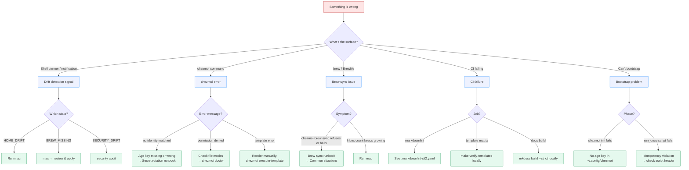

# Troubleshooting

Symptom-driven index. Find your error message, jump to the fix.



## chezmoi errors

### `chezmoi apply` fails with "no identity matched any of the recipients"

**Cause**: The private age key at `~/.config/chezmoi/key.txt` is missing, world-readable, or doesn't match the recipient declared in `.chezmoi.toml.tmpl`.

**Fix**:

```bash
# 1. Confirm the key file exists and has 0600 perms.
ls -l ~/.config/chezmoi/key.txt
# Expected: -rw------- 1 ed staff ...

# 2. Confirm the public half matches the recipient.
age-keygen -y ~/.config/chezmoi/key.txt
# Compare against `recipient` line in .chezmoi.toml.tmpl.

# 3. If you've rotated the key recently but didn't re-encrypt all blobs,
#    follow Secret rotation → "Rotate the age key itself".
```

See [Secret rotation](runbooks/secret-rotation.md).

### `chezmoi verify` returns non-zero with empty stderr

**Cause**: A file in `$HOME` has different permissions than the source expects, but the *content* matches. `verify` checks both.

**Fix**: Run `chezmoi apply -v` (verbose) to see what specifically is being changed. Usually a permission fix.

## Brew sync issues

`chezmoi-brew-sync` refuses to start or bails out in four known ways. Each has its fix in the [Brew sync runbook](runbooks/brew-sync.md#common-situations):

| Message or symptom | Short answer |
|---|---|
| "Brewfile.tmpl has uncommitted changes" | Commit or discard them, or pass `--force` to stash |
| "no tty available" | Run it from an interactive terminal |
| Validation failed and it bailed | Inspect the temp file it names, fix `Brewfile.tmpl`, re-run |
| A `mas` event asks for an app name | Look it up with `mas info <id>` |

The journal it reads is `~/.cache/chezmoi-brew-inbox/journal.ndjson`. `~/.cache/brewup.log` is the daily upgrade's output, not the journal.

## Drift detection

### Shell banner shows drift but `mac` says nothing's pending

**Cause**: The banner reads a cache (`~/.cache/chezmoi-drift/state`); `mac` re-runs the full check. A fix made outside `chezmoi apply`, `brew`, `mas` or `mac` leaves the cache stale for up to 4 hours.

**Fix**: Run `mac` — it rewrites the cache. If the banner is still wrong in the next shell, drop the cache and run it again:

```bash
rm -rf ~/.cache/chezmoi-drift
mac
```

### Banner shows `brewup-failed`

**Cause**: The daily `brewup` run exited non-zero and left `~/.cache/brewup.failed`. The marker is removed automatically by the next successful run.

**Fix**:

```bash
brewlog          # tail ~/.cache/brewup.log; the error is under the newest '=== brewup' header
brewup           # re-run once the cause is addressed
```

The most common cause is a **wedged cask staging directory**. An interrupted cask upgrade leaves the old app behind in the Caskroom, and every later upgrade aborts with:

```text
Error: <cask>: It seems there is already an App at
'/opt/homebrew/Caskroom/<cask>/<old-version>/<Name>.app'.
```

A full app inside a Caskroom version directory is always wreckage — Homebrew *moves* cask apps to `/Applications` and leaves only metadata behind. Clear it and reinstall:

```bash
rm -rf "/opt/homebrew/Caskroom/<cask>/<old-version>"
brew install --cask --force <cask>
```

Never use `brew uninstall --zap` here: `--zap` deletes application support data (browser profiles, bookmarks, licences), not just the app.

### `brew upgrade` touches a self-updating app (Chrome, Brave)

**Not a bug.** Casks marked `auto_updates true` are normally skipped without `--greedy`, but `HOMEBREW_UPGRADE_AUTO_UPDATES_CASKS` defaults to on, so Homebrew reads the real version out of the installed app's `Info.plist` and re-syncs when the app has fallen behind the tap. That is how an app updated in place by its own updater (Chrome's Keystone, which writes to `/Applications` as root) gets reconciled with Homebrew's records.

Keep these casks tracked in `Brewfile.tmpl` — `brew bundle check` only tests presence, not version, so a self-updated app still satisfies it. To opt out of the reconciliation, set `HOMEBREW_NO_UPGRADE_AUTO_UPDATES_CASKS=1`.

### Daily 09:30 notification didn't fire

**Cause**: Usually there was no drift — the notification is posted only when there is something to report. Otherwise the LaunchAgent isn't loaded, or the Mac was powered off or logged out at 09:30. A Mac that was only asleep runs the job on wake.

**Fix**:

```bash
# Confirm the LaunchAgent is loaded.
launchctl list | grep chezmoi-drift

# Trigger manually.
launchctl kickstart -k gui/$UID/com.user.chezmoi-drift

# See what the last run reported.
tail ~/Library/Logs/chezmoi-drift.log
```

See [Recover from drift](runbooks/recover-from-drift.md).

## CI failures

### `markdownlint` fails on a file you didn't edit

**Cause**: A new markdownlint rule version flagged something that was always there. The repo's `.markdownlint-cli2.yaml` disables several rules (line length, inline HTML and bare URLs among them); a new rule may need disabling.

**Fix**: Read the failing rule's docs ([rule list](https://github.com/DavidAnson/markdownlint/blob/main/doc/Rules.md)). If genuinely a false positive for this project, add to `.markdownlint-cli2.yaml`.

### `chezmoi templates (work / amd64)` fails

**Cause**: A template branch is referenced for one machine_type or arch but not implemented.

**Fix**:

```bash
# Reproduce locally.
make verify-templates

# Or just the failing cell.
chezmoi execute-template \
    --init --source="$(pwd)" \
    --override-data '{"machine_type":"work","gpg_signing_key":"test","chezmoi":{"arch":"amd64"}}' \
    < path/to/failing.tmpl
```

### `docs checks passed` fails with "mkdocs build --strict" error

**Cause**: New page added but not in `nav:`; or a `[link][undef]` reference; or a code block has an unknown language tag.

**Fix**:

```bash
# Reproduce locally (after pip install -r docs/requirements.txt).
mkdocs build --strict
```

See [Branch protection](runbooks/branch-protection.md).

## Bootstrap problems

### First `chezmoi init --apply edjchapman` fails immediately

**Cause**: The age private key isn't in `~/.config/chezmoi/key.txt`.

**Fix**: Drop the key file there first, then re-run `chezmoi init`. The [new-machine runbook](runbooks/new-machine.md) covers the full procedure.

### `run_once_*` script fails on second run

**Cause**: Idempotency violation. `run_once` scripts should be re-entrant; if they can't, they need state-detection at the top.

**Fix**: Run `chezmoi state delete-bucket --bucket=scriptState` to wipe the state DB and re-run. **This is destructive** — re-runs every `run_once_*` again.

## GPG problems

### GPG Services "Decrypt Selection" fails with `Decryption failed code = 152`

**Cause**: 152 is `GPG_ERR_DECRYPT_FAILED` — libgpg-error's catch-all, so it names nothing useful. The usual cause on this machine is **not** a missing or expired key: it's that Homebrew's `gnupg` 2.5 (a transitive dependency of `gpgme`/`gpgmepp`/`poppler`, ahead of MacGPG2 on `PATH`) started `gpg-agent` first and claimed `~/.gnupg/S.gpg-agent`. That agent serves the GUI service too, and Homebrew ships only `pinentry-curses` — so the GUI decrypt is handed a terminal prompt with no terminal.

**Fix**: `~/.gnupg/gpg-agent.conf` should pin the GUI pinentry. It is chezmoi-managed, so restore it from source rather than editing `$HOME`:

```bash
chezmoi diff ~/.gnupg/gpg-agent.conf
chezmoi apply ~/.gnupg/gpg-agent.conf
gpgconf --kill gpg-agent   # respawns on next use with the new config
```

**Confirm the fix**: stderr only ever says "decryption failed"; the `--status-fd` stream names the pinentry that actually launched.

```bash
gpg --batch --status-fd 2 --decrypt msg.asc 2>&1 >/dev/null \
  | grep -E 'PINENTRY_LAUNCHED|NO_SECKEY|DECRYPTION_(OKAY|FAILED)'
```

`PINENTRY_LAUNCHED … mac` is healthy; `… curses` is the broken state. A genuine `NO_SECKEY` means the key really is absent — a different problem. To see which agent holds the socket, `gpg-connect-agent 'GETINFO version' /bye` prints its version (2.2 is MacGPG2, 2.5 is Homebrew's).

**Why the pin works**: both agents read the same `gpg-agent.conf`, so the outcome no longer depends on which one started first. `pinentry-mac` can also reach the macOS Keychain for a saved passphrase, which `pinentry-curses` cannot.

See [Gotchas → Two GnuPG installations share one `~/.gnupg`](gotchas.md#macos-specific-traps) for the rule this taught.

## Network

Wi-Fi latency spikes, HTTPS timeouts and drops while docked have their own page: [Network slowdowns](runbooks/network-slowdowns.md). Start there with `net-check` to find the slow hop.

## System extensions

### A removed app's system extension is still loaded

**Cause**: `brew uninstall` (even with `--zap`) deletes the app without deactivating its system extension, and only the owning app can. It stays `[activated enabled]` across reboots; `systemextensionsctl uninstall` refuses while SIP is on.

```bash
systemextensionsctl list | grep -i <vendor>
```

**Check its type first.** The unfiltered list groups extensions by type, and only `network_extension` sits in the packet path. `endpoint_security` ones — like NordVPN's leftover `com.nordvpn.macos.Shield` — never touch packets, but they must approve every launch and file access, so a slow one can stall the whole Mac; don't rule one out on type alone.

**Fix**: the System Settings ➜ General ➜ Login Items & Extensions list doesn't show an extension whose app is gone, so there's nothing to toggle, and killing the process fails because launchd relaunches it as root. Instead, reinstall the cask, launch it once (an unopened copy doesn't own the old extension), then drag it to the Bin and accept the prompt to remove its extensions. Then `brew uninstall --cask --zap <cask>`. To avoid it, remove extension-carrying apps through Finder or their uninstaller before dropping the cask.

NordVPN's leftover `com.nordvpn.macos.Shield` stayed `[activated enabled]` through every restart until the macOS 27.2 update, after which `systemextensionsctl list` showed none, so a major OS update may clear an orphan too.

**App still installed?** Switch the extension off instead, under its type in the same Login Items & Extensions pane (`systemextensionsctl list` names the pane), and restart.

## See also

- [Recover from drift](runbooks/recover-from-drift.md)
- [Secret rotation](runbooks/secret-rotation.md)
- [Brew sync](runbooks/brew-sync.md)
- [Network slowdowns](runbooks/network-slowdowns.md)
- [Gotchas](gotchas.md)
- [FAQ](faq.md)
